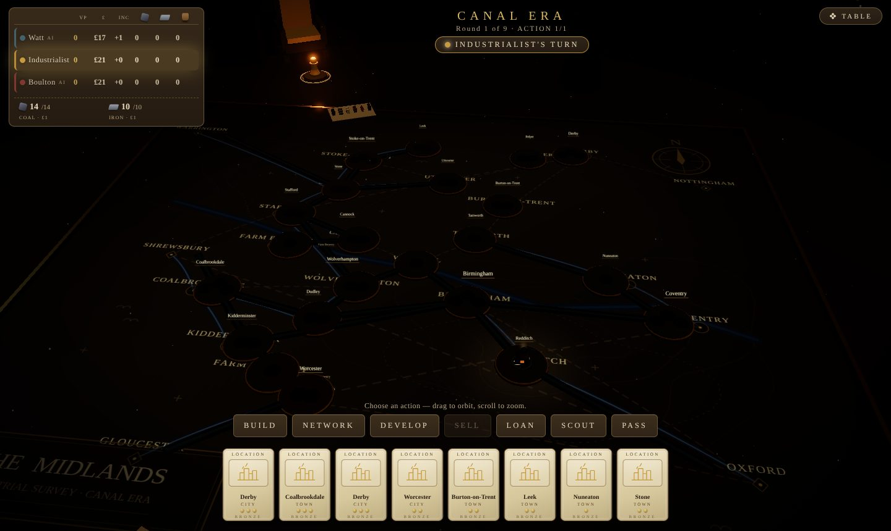
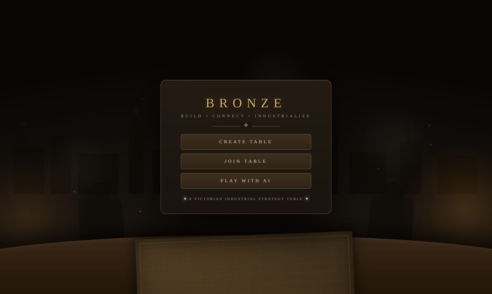
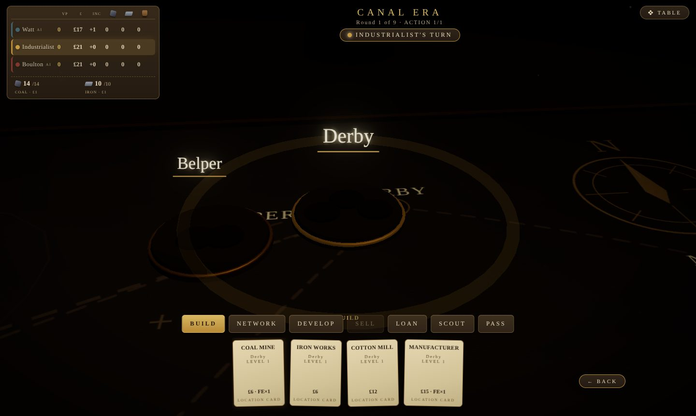
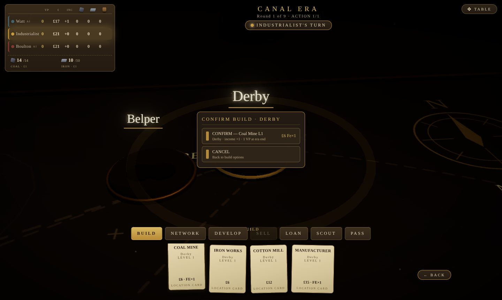
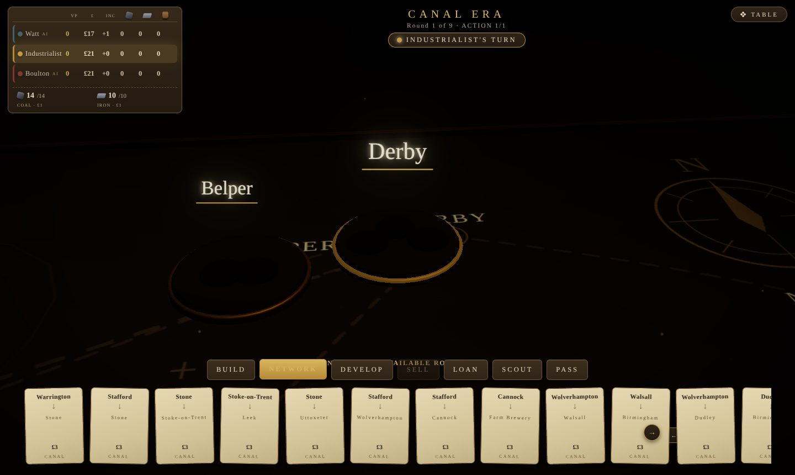
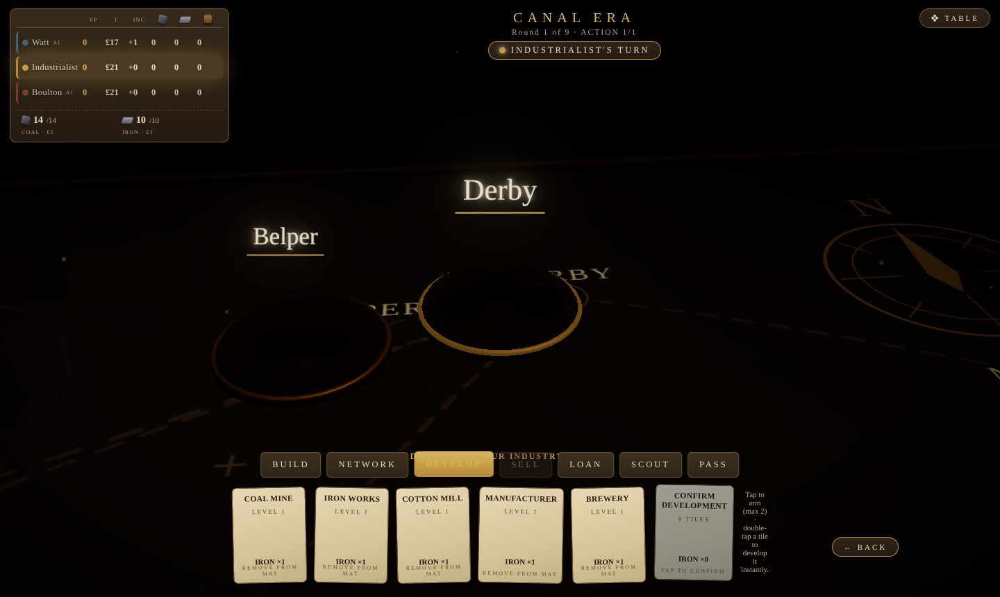

# Bronze

### ▶ [Play now: naman-verma-02.github.io/bronze](https://naman-verma-02.github.io/bronze/)

A free, browser-based 3D strategy board game about building canals, railways and industry across the 1770s Midlands. Sit at a Victorian workshop tabletop and play against up to three AI opponents. No install, no account.



> Bronze is a free fan project, not affiliated with Roxley Games or Martin Wallace. It uses original code and art only.

## How it looks and plays

You are an industrialist with a hand of location cards and a few pounds. Every turn you spend actions to build industries, lay canals (later railways), sell goods, take loans and scout for wild cards. The board is lit by what you build: connected routes glow, silent ones stay dark.

| | |
|---|---|
|  |  |
| **Home.** Create a table, join one, or play with AI. | **Pick a card.** Click a hand card to see only what it can build. |
|  |  |
| **Confirm.** Choose an option, check the cost, confirm on the board. | **Network.** Every legal canal or railway link appears as a card. |



### Controls

- **Hand card:** click to select it. The tray shows that card's build options. **BACK** returns to your hand.
- **Option card:** click to open the cost preview over the city, then confirm.
- **Loan, Scout, Pass:** tap the card once to arm it, tap again to confirm.
- **Develop:** tap up to two industries, then the confirm card (or double-tap one to develop it at once).
- **Camera:** drag to orbit, scroll to zoom. **TABLE** menu: music, sound, restart.

## Rules in short

**Goal.** Finish with the most victory points (VP) after two eras. Ties go to the higher income, then the most money.

**Setup.** 2 to 4 players. Everyone starts with money (£17 for two players, £21 for three, £24 for four) and an 8-card hand. The Canal Era lasts 10, 9 or 8 rounds for 2, 3 or 4 players, and the Rail Era the same.

**Turns.** The first round of the game gives each player one action; after that each player takes two. Turn order each round follows who spent least. Every action costs you one card from your hand.

**Actions**

| Action | What it does |
|---|---|
| **Build** | Place your lowest-level tile of an industry (coal mine, iron works, cotton mill, manufacturer, pottery, brewery) in a city. A location card builds in that city; an industry card builds that industry. Costs money, and some tiles also cost iron or beer. |
| **Network** | Lay a link between towns: a canal for £3 in the Canal Era, a railway for £5 plus coal in the Rail Era. In the Rail Era you can lay two at once for £15, coal ×2 and beer. |
| **Develop** | Spend iron to remove up to two of your lowest tiles from your mat, so better ones come up. |
| **Sell** | Sell cotton, manufacturer or pottery goods through a connected merchant. The tile flips and starts to earn points and income. |
| **Loan** | Take £30. Your income drops three levels. |
| **Scout** | Discard three cards to get one wild location and one wild industry card. |
| **Pass** | Discard a card and do nothing. |

**Income and money.** Flipped industries raise your income level. At the end of each round you collect income (or pay if it is negative).

**Scoring.** At the end of each era, every link you own scores VP for the towns and cities it touches, and every flipped industry scores its printed VP. After the Canal Era the canals are removed and all level-1 industries leave the board; the Rail Era starts with a fresh network.

Bronze follows the published rules of this kind of game closely but is not a full copy of them; `HOW_TO_RUN.md` lists known simplifications.

## Run it yourself

```bash
npm install
npm run client      # http://localhost:5173
```

| Command | What it does |
|---|---|
| `npm run typecheck` | TypeScript check for every workspace |
| `npm test` | Rules tests and randomized full-game smoke games |
| `npm run test:smoke` | Browser tests (needs `vite preview` on port 4173) |
| `npm run build` | Production build into `client/dist/` |

See `HOW_TO_RUN.md` for the file map and known rule simplifications. The live site is deployed from `main` to GitHub Pages by `.github/workflows/pages.yml`.

## License

MIT for the code. See `LICENSE`.
