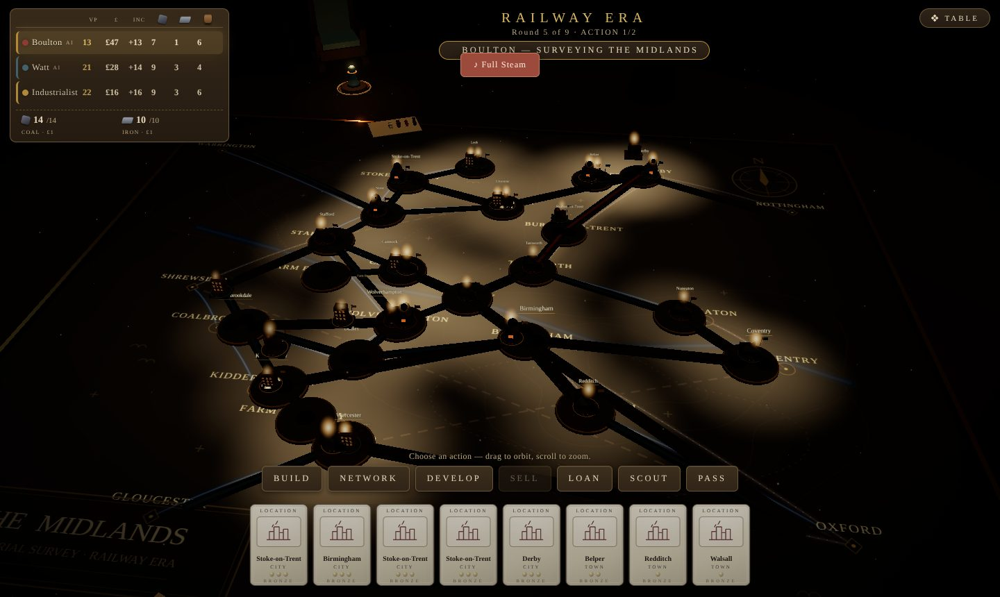

<div align="center">

# BRONZE

**Build. Connect. Industrialize.**

A free 3D strategy board game about canals, railways and industry in the 1770s Midlands.<br/>
Play in your browser against AI industrialists on a candle-lit Victorian tabletop.

### [▶&nbsp;&nbsp;PLAY NOW&nbsp;&nbsp;·&nbsp;&nbsp;naman-verma-02.github.io/bronze](https://naman-verma-02.github.io/bronze/)

No install. No account. Works on any modern desktop browser with WebGL.



<sub>Bronze is a free fan project, not affiliated with Roxley Games or Martin Wallace. It uses original code and art only.</sub>

</div>

---

## What you get

- **A real tabletop.** A 3D board with miniature industries, glowing routes and a hand of location cards. The map lights up as your network grows.
- **Two eras.** Lay canals in the Canal Era, then start over with railways in the Rail Era.
- **Smart AI rivals.** Play against one to three AI industrialists at three difficulty levels.
- **Seven actions, one clear flow.** Pick a card, see exactly what it can do, confirm on the board.
- **Atmosphere.** A generative soundtrack, sound effects and an opening cinematic.
- **Pick up where you left off.** The game autosaves; use **Continue game** on the home page.

## Your first turn

1. Press **Play with AI** on the home page, choose your opponents and begin.
2. Click a card in your hand. The tray shows only what *that card* can build.
3. Click an option card (an industry, its level and its cost). A preview opens over the city.
4. Confirm. The tile appears on the board and your turn passes on.

Use **BACK** at any time to return to your hand.

| | |
|---|---|
|  |  |
| **Home.** Create a table, join one, or play with AI. | **Pick a card.** Only that card's build options appear. |
|  |  |
| **Confirm.** Check the cost, then confirm on the board. | **Network.** Every legal link is a card. |


<sub>**Develop.** Spend iron to clear your lowest tiles so better ones come up.</sub>

### Controls

| Do this | To do that |
|---|---|
| Click a hand card | Select it and see its build options |
| Click an option card | Preview the cost on the board, then confirm |
| Tap **Loan**, **Scout** or **Pass** twice | Arm, then confirm |
| Tap up to two tiles in **Develop**, then the confirm card | Develop them (or double-tap one to develop it at once) |
| Drag / scroll | Orbit and zoom the camera |
| **TABLE** menu | Music, sound, restart |

## Rules in short

**Goal.** Finish with the most victory points (VP) after both eras. Ties go to the higher income, then to the most money.

**Setup.** 2 to 4 players. Starting money is £17 for two players, £21 for three and £24 for four. Everyone holds 8 cards. Each era lasts 10, 9 or 8 rounds for 2, 3 or 4 players.

**Turns.** The first round of the game gives each player one action; afterwards each player takes two. Turn order each round follows who spent least. Every action costs you one card from your hand.

### The seven actions

| Action | What it does |
|---|---|
| **Build** | Place your lowest-level tile of an industry (coal mine, iron works, cotton mill, manufacturer, pottery or brewery) in a city. A location card builds in that city; an industry card builds that industry. Costs money, and some tiles also cost iron or beer. |
| **Network** | Lay a link between towns: a canal for £3 in the Canal Era, a railway for £5 plus coal in the Rail Era. In the Rail Era you can lay two at once for £15, coal ×2 and beer. |
| **Develop** | Spend iron to remove up to two of your lowest tiles, so better ones come up. |
| **Sell** | Sell cotton, manufacturer or pottery goods through a connected merchant. The tile flips and starts to earn points and income. |
| **Loan** | Take £30. Your income drops three levels. |
| **Scout** | Discard three cards to get one wild location and one wild industry card. |
| **Pass** | Discard a card and do nothing. |

### Money and scoring

- **Income.** Flipped industries raise your income level. At the end of each round you collect your income, or pay if it is negative.
- **End of an era.** Every link you own scores VP for the towns and cities it touches, and every flipped industry scores its printed VP.
- **Canal to Rail.** After the Canal Era the canals are removed and all level-1 industries leave the board. The Rail Era starts with a fresh network.

### Glossary

| Term | Meaning |
|---|---|
| **Flip** | A sold or exhausted tile turns over: it now scores VP and raises income. |
| **Level** | Tiles come in levels; higher levels cost more and score more. |
| **Wild card** | A card that builds anywhere (location) or any industry (industry). Only Scout gives them. |
| **Merchant** | A trading town at the edge of the board where goods are sold. |

Bronze follows the published rules of this kind of game closely but is not a full copy of them. `HOW_TO_RUN.md` lists known simplifications.

## Run it yourself

```bash
npm install
npm run client      # http://localhost:5173
```

| Command | What it does |
|---|---|
| `npm run typecheck` | TypeScript check for every workspace |
| `npm test` | Rules tests and randomized full-game smoke games |
| `npm run test:smoke` | Browser tests (needs `vite preview` on port 4173) |
| `npm run build` | Production build into `client/dist/` |

The live site is deployed from `main` to GitHub Pages by `.github/workflows/pages.yml`. See `HOW_TO_RUN.md` for the file map.

**Built with** TypeScript, Three.js, GSAP, Vite and Playwright.

## License

MIT for the code. See `LICENSE`.
Requested by naman · project thread

Before: The README was a short intro with run commands only. It had no screenshots, no rules and no link to the live game.

After: The README opens with a "Play now" link to the live game and a screenshot of the table. It then covers how the game looks and plays (six real screenshots in docs/screens/), card controls, a short rules summary (goal, setup, actions, income, scoring) and run instructions.

How: The screenshots were taken from the built game with Playwright. The rules text was checked against shared/src/bronze/state.ts. No code changes.

